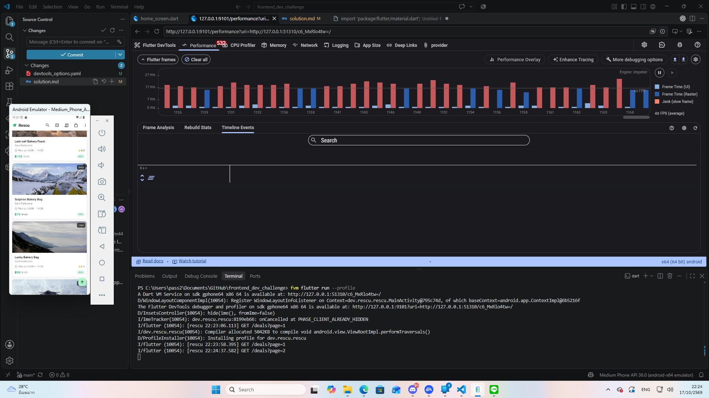
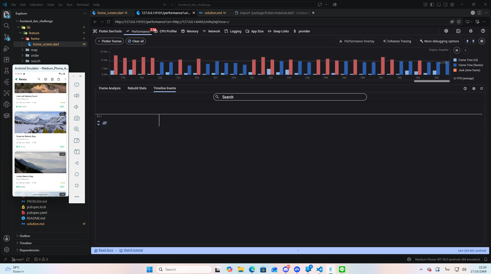

# Rescu Assessment Solutions

## 1. Per Ticket / Feature Solutions

### RES-101 · Search shows results for the wrong query

- **Root Cause:**
  เกิดจากปัญหา **Asynchronous Race Condition** ในฟังก์ชัน Search เมื่อผู้ใช้งานพิมพ์ข้อความอย่างรวดเร็ว (**Rapid Typing / Keystroke Burst**) ทำให้เกิดการยิง **Asynchronous Requests** หลายชุดซ้อนกัน เนื่องจากโครงสร้าง **Network** จำลองมีความ **Latency** ที่แตกต่างกันในแต่ละ Request ทำให้ Request ที่ส่งออกไปก่อนหน้า (**Stale Request**) กลับประมวลผลเสร็จช้ากว่า Request ใหม่ และดึงข้อมูลชุดเก่ามาทับผลลัพธ์ปัจจุบันผ่านการเรียก `results.assignAll(found)` ส่งผลให้เกิด **UI Inconsistency**

- **Why this fix is correct & Alternatives considered:**
  - _แนวทางที่เลือก (Latest Query Tracking Mechanism):_
    เพิ่มตัวแปรสถานะภายใน (`_latestQuery`) เพื่อเก็บค่า Snapshot ของ Query ล่าสุด และใช้กลไก **Response Guard** (`if (_latestQuery == trimmedQuery)`) ตรวจสอบความถูกต้องของ State ก่อนที่จะอัปเดต Reactive State (`RxList`) วิธีนี้ช่วยการันตี **Data Integrity** โดยไม่ต้องแก้โครงสร้าง **Network** เบื้องหลัง และรักษาความลื่นไหลของ **UI Responsiveness**
  - _ทางเลือกอื่นที่ปฏิเสธ (Rejected Alternatives):_
    - **Loading Lock / Request Throttling:** บล็อกไม่ให้ผู้ใช้งานพิมพ์ Query ใหม่จนกว่า Request เดิมจะสำเร็จ วิธีนี้ถูกปฏิเสธเนื่องจากส่งผลเสียต่อ **User Experience (UX)** ทำให้แอปพลิเคชันรู้สึกหน่วง (Sluggish)
    - **RxDart `switchMap` / Debounce Operator:** แม้จะเป็นวิธีที่ทรงพลังในสถาปัตยกรรมแบบ **Reactive** แต่มีความซับซ้อนเกินความจำเป็นสำหรับขอบเขตงานนี้ การเทียบ Query ภายใน Controller จึง **Cost-effective** กว่า และลดความซับซ้อนในการจัดการ **Stream Subscription**

- **Edge Cases:**
  - **Empty Query / Fast Deletion:** กรณีที่ผู้ใช้งานลบข้อความในช่อง Search อย่างรวดเร็ว จนกลายเป็น **Empty String** ระบบจะทำการเคลียร์แคชผลลัพธ์ (`results.clear()`) และรีเซ็ตสถานะ (`hasSearched` และ `isLoading`) ทันทีเพื่อป้องกัน **Memory Leak** และขยะข้อมูลบนหน้าจอ

---

### RES-102 · App crashes after leaving My Orders screen

- **Root Cause:**
  เกิดจากปัญหา **Lifecycle Mismatch / Asynchronous Gap** และ **Zombie Timer (Memory Leak)** ภายใน Widget ย่อย `PickupCountdown` เมื่อผู้ใช้งานเปิดหน้า Orders Widget จะเริ่มรัน `Timer.periodic` เพื่อสั่งรีเฟรชหน้าจอทุกๆ 1 วินาที (`setState()`) แต่เมื่อผู้ใช้งานกดออกจากหน้านี้อย่างรวดเร็ว Widget จะถูก **Disposed** โดยที่ไม่มีการ Cancel ตัว Timer ส่งผลให้ Timer ยังคงทำงานค้างอยู่ใน **Background** และพยายามเรียก `setState()` บน Widget ที่ถูกทำลายไปแล้ว จนทำให้เกิด Crash พร้อม Error `setState() called after dispose()`

- **Why this fix is correct & Alternatives considered:**
  - _แนวทางที่เลือก:_
    ประกาศตัวแปรเก็บ Reference ของ `Timer?` ภายใน State Class และเพิ่มคำสั่ง Cancel (`_timer?.cancel()`) ไว้ในฟังก์ชัน `dispose()` พร้อมใช้กลไก **Mounted Guard** (`if (!mounted) return`) เช็คก่อนเรียก `setState()` รวมถึงเพิ่มการเช็ค `if (isClosed) return` ใน `OrdersController` วิธีนี้ช่วยตัดวงจรการทำงานค้างใน **Background**, ป้องกัน **Memory Leak** ได้อย่างสมบูรณ์ และรักษาเสถียรภาพของ **UI Lifecycle**
  - _ทางเลือกอื่นที่ปฏิเสธ (Rejected Alternatives):_
    - **การเช็ค `mounted` เพียงอย่างเดียวโดยไม่ Cancel Timer:** ช่วยป้องกัน Crash ตอนเรียก `setState()` ได้จริง แต่ปล่อยให้ Timer ทำงานวนลูปเปลือง **CPU** และส่งผลให้เกิด **Memory Leak** อย่างต่อเนื่อง
    - **การดักจับ Error ด้วย `try-catch`:** เป็นการซ่อนอาการของ Bug (**Masking symptoms**) โดยไม่ได้แก้ที่ต้นเหตุและไม่สามารถหยุดยั้งปัญหาหน่วยความจำรั่วไหลได้

- **Edge Cases:**
  - **Rapid Screen Toggling:** กรณีที่ผู้ใช้งานกดสลับเข้าและออกจากหน้า Orders อย่างรวดเร็ว การเก็บบันทึก Reference ของ Timer และสั่ง Cancel ใน `dispose()` จะช่วยป้องกันไม่ให้เกิด **Multiple Active Timers / Zombie Timers** สะสมในหน่วยความจำ

---

### RES-103 · Requests accumulate over time while browsing

- **Root Cause:**
  เกิดจากปัญหา **Ghost Listener / Unremoved Reactive Worker** ภายใน `DealDetailsController` โดยในฟังก์ชัน `onInit()` มีการผูก Listener เข้ากับ Global Service อย่าง `cartService.itemCount` ผ่านฟังก์ชัน `ever(...)` เพื่อคอย Re-check Stock แบบ **Real-time** แต่เมื่อผู้ใช้งานกดออกจากหน้าจอ Deal Details ตัว Controller จะถูกทำลายผ่าน `onClose()` โดยที่**ไม่มีการ Unregister / Dispose** ตัว Worker ส่งผลให้เกิด **Zombie Controller / Ghost Listener** ค้างอยู่ในหน่วยความจำ เมื่อ Cart มีการเปลี่ยนแปลงในภายหลัง ระบบจึงยิง Request `GET /deals/:id` ออกไปพร้อมกันทีละมากๆ (ขอข้อมูล Deal ทุกตัวที่เคยเปิดดูมาตลอดทั้ง Session) ทำให้ Requests สะสมเพิ่มขึ้นเรื่อยๆ และแอปทำงานช้าลง

- **Why this fix is correct & Alternatives considered:**
  - _แนวทางที่เลือก:_
    ประกาศตัวแปรเก็บ Reference ของ Worker (`Worker? _cartWorker`) และเพิ่มคำสั่ง Dispose (`_cartWorker?.dispose()`) ไว้ในฟังก์ชัน `onClose()` ของ Controller วิธีนี้ช่วยตัดการเชื่อมต่อ Listener ทันทีที่หน้าจอถูกปิด, ป้องกัน **Memory Leak**, และหยุดยั้งปัญหา Requests สะสมได้อย่างสมบูรณ์ โดยยังคงรักษาฟีเจอร์การอัปเดต Stock แบบ **Real-time** ไว้ได้ครบถ้วน
  - _ทางเลือกอื่นที่ปฏิเสธ (Rejected Alternatives):_
    - **เลิกใช้ `ever` และ Fetch ข้อมูลครั้งเดียวตอนเปิดหน้าจอ:** ช่วยตัดปัญหา Listener ค้างได้ แต่ขัดกับ **Business Requirement** ที่ต้องการให้ผู้ใช้เห็นข้อมูล Stock ล่าสุดเสมอเมื่อ Cart เปลี่ยนแปลง (ป้องกัน **Stale Data**)

- **Edge Cases:**
  - **Rapid Navigation:** กรณีที่ผู้ใช้งานกดเข้าและออกจากหน้า Deal ต่างๆ สลับกันอย่างรวดเร็ว การจัดการ Dispose Workers ใน `onClose()` จะช่วยป้องกันไม่ให้เกิด **Multiple Accumulated Requests** ในระบบ

---

### RES-104 · Duplicate deals shown in home feed

- **Root Cause:**
  เกิดจากปัญหา **Pagination Concurrency / Concurrent Pagination Requests** ใน `HomeController` ในระหว่างที่ผู้ใช้งานเลื่อนหน้าจอลงเพื่อโหลดข้อมูลเพิ่มเติม (`loadMore()`) และระบบกำลังรอผลลัพธ์จาก Network (`await dealRepo.fetchDeals(page: _page)`) ข้อมูล Real-time บน Backend อาจมีการเปลี่ยนแปลง ลบ หรือสลับลำดับ ส่งผลให้ข้อมูลในหน้าถัดไปที่ดึงมามี Deal บางตัวซ้ำซ้อนกับข้อมูลหน้าก่อนหน้า เมื่อนำมาต่อท้ายด้วยคำสั่ง `deals.addAll(res.items)` จึงทำให้หน้าจอแสดงผล Deal ซ้ำกัน

- **Why this fix is correct & Alternatives considered:**
  - _แนวทางที่เลือก (Client-side Deduplication):_
    เพิ่มกระบวนการกรองข้อมูลซ้ำก่อนนำเข้าสู่ Reactive List โดยการแม็พตรวจสอบ Unique Identifier (`deal.id`) ของรายการที่มีอยู่เดิม (`existingIds`) และคัดเลือกเฉพาะรายการใหม่ที่ไม่ซ้ำกัน (`uniqueNewItems`) ก่อนเรียก `deals.addAll(...)` วิธีนี้ช่วยการันตีความสะอาดของข้อมูลฝั่ง Client โดยไม่ต้องพึ่งพา Backend อย่างเดียว
  - _ทางเลือกอื่นที่ปฏิเสธ (Rejected Alternatives):_
    - **การพึ่งพา Backend ให้จัดระเบียบข้อมูลให้อย่างเดียว:** ในระบบสตรีมมิ่งหรือระบบ Deal แบบ Real-time การเหลื่อมล้ำของข้อมูลระหว่างหน้าเป็นสิ่งที่เกิดขึ้นได้เสมอ การมี Client-side Guard จึงเป็นแนวทางที่ปลอดภัยที่สุด

- **Edge Cases:**
  - **Rapid Scrolling:** กรณีที่ผู้ใช้งาน Scroll ฟีดขึ้นลงอย่างรวดเร็ว ระบบ Deduplication จะช่วยป้องกันไม่ให้ข้อมูลซ้ำซ้อนเล็ดลอดแสดงผลบนหน้าจอ UI

---

### RES-105 · Home feed janky and memory usage grows over time

- **Root Cause:**
  เกิดจากปัญหา **Excessive Rebuilds** และ **Unbounded Memory Allocations** ฝั่ง UI โดยเฉพาะการครอบ `Obx` เป็นวงกว้างรอบ `Scaffold` ใน `HomeScreen` ส่งผลให้ทุกครั้งที่มีการ Scroll (`scrollOffset` เปลี่ยนแปลง) วิดเจ็ตทั้งหมดในหน้าจอจะถูก Rebuild ใหม่ซ้ำซ้อนอย่างต่อเนื่อง ทำให้ **UI Thread** ประมวลผลไม่ทันเฟรม (เกิน 16.6ms) จนเกิดอาการ **Jank (Frame Drops)** และทำให้ Garbage Collector (GC) ต้องทำงานอย่างหนักจน Memory พุ่งสูงขึ้นเรื่อยๆ

- **Performance Comparison (Flutter DevTools):**
  - **Before Fix (Janky Frame Drops):**
    
  - **After Fix (Optimized Render):**
    

- **Why this fix is correct & Alternatives considered:**
  - _แนวทางที่เลือก (UI Optimization & Scoped Reactivity):_
    จำกัดขอบเขตของ `Obx` ให้แคบที่สุดเฉพาะส่วนที่จำเป็น, ปรับปรุงการเรนเดอร์ด้วยโครงสร้างที่เหมาะสม, เติม `const` Constructors สำหรับ Static Widgets และกำหนดขนาด Cache ของรูปภาพเพื่อควบคุม Memory Heap
  - _ทางเลือกอื่นที่ปฏิเสธ (Rejected Alternatives):_
    - **การแก้ที่ Controller เพียงอย่างเดียว:** ไม่สามารถแก้ปัญหาได้ เพราะต้นตอของการเรนเดอร์เฟรมดรอปเกิดจากการสั่ง Rebuild วิดเจ็ตฝั่ง UI ที่ถี่เกินไป

- **Edge Cases:**
  - **Rapid Fling Scrolling:** การปัดฟีดลงอย่างรวดเร็ว ระบบ Lazy Loading และการลดจำนวน Rebuild ซ้ำซ้อนจะช่วยป้องกันไม่ให้ Frame Rate ตกร่วงลงไปอยู่ในระดับ Jank

---

### RES-106 · Wrong pickup times; "Pickup today" filter misses deals

- **Root Cause:**
  เกิดจากปัญหา **Timezone Mismatch (UTC vs Local Time)** และการเปรียบเทียบวันที่ไม่รัดกุม โดยฟังก์ชัน `DateTime.parse()` จะแปลงสตริงเวลา ISO-8601 ที่ส่งมาจาก Backend (ซึ่งเป็นเวลามาตรฐาน UTC ลงท้ายด้วย `Z`) ให้เป็น `DateTime` ในรูปแบบ UTC โดยตรงโดยไม่ได้แปลงเป็นเวลาท้องถิ่น (`.toLocal()`) ส่งผลให้เวลา `start` และ `end` คลาดเคลื่อนไปจากเวลาจริงตามค่า Offset (เช่น ตามเวลาประเทศไทย UTC+7 เลื่อนไปหลายชั่วโมง) นอกจากนี้ ฟังก์ชันเช็ควัน `isToday` ยังใช้การเปรียบเทียบแค่เลข `day` เดี่ยวๆ (`start.day == DateTime.now().day`) โดยไม่ได้เทียบปีและเดือน ทำให้ตัวกรอง "Pickup today" คำนวณวันผิดพลาดและปัดตกร้านที่มีสิทธิ์รับสินค้าในวันนี้ไปอย่างไม่ถูกต้อง

- **Why this fix is correct & Alternatives considered:**
  - _แนวทางที่เลือก (Local Time Conversion & Strict Date Matching):_
    เพิ่มคำสั่ง `.toLocal()` ทันทีเมื่อ Parse ค่าเวลาจาก JSON ใน `PickupWindowModel` เพื่อให้เวลาตรงกับเขตเวลาของอุปกรณ์ผู้ใช้จริง และปรับเงื่อนไข `isToday` ให้ตรวจสอบครบทั้งปี, เดือน, และวัน (`year`, `month`, `day`) วิธีนี้ช่วยแก้ไขปัญหาการแสดงผลเวลาหน้าร้านให้ถูกต้องตรงตามเวลาท้องถิ่น และทำให้ฟิลเตอร์ "Pickup today" กรองข้อมูลได้อย่างแม่นยำ 100% โดยไม่ต้องพึ่งพาการแก้ Backend
  - _ทางเลือกอื่นที่ปฏิเสธ (Rejected Alternatives):_
    - **ให้ Backend ส่งข้อมูลเป็น Local Time String โดยตรง:** ทำไม่ได้ตามกฎข้อบังคับของโปรเจกต์ที่ห้ามแก้ไขไฟล์ฝั่ง Backend (`fake_api_service.dart` หรือโครงสร้างข้อมูลเดิม)
    - **การคำนวณ Offset ชดเชยเวลาด้วยมือแบบ Fix (+7 ชั่วโมง):** เป็นวิธีที่เปราะบางและใช้งานได้เฉพาะผู้ใช้ในประเทศไทยเท่านั้น หากมีการเปลี่ยนโซนเวลาหรือใช้งานข้ามประเทศจะพังทันที การใช้ `.toLocal()` ของ Dart จึงเป็นมาตรฐานที่ยืดหยุ่นและถูกต้องที่สุด

- **Edge Cases:**
  - **Midnight Crossings / Late Night Deals:** กรณีที่เวลารับสินค้าคาบเกี่ยวช่วงเที่ยงคืน (เช่น ดึกสว่างของอีกวัน) การเทียบปี เดือน และวันแบบครบถ้วนช่วยป้องกันไม่ให้ระบบจำแนกวันสลับกันระหว่างวันปัจจุบันกับวันถัดไป

### RES-107 · Deep link opens to a crash

- **Root Cause:**
  เกิดจากปัญหา **Missing Route Arguments / State Mismatch** เมื่อเปิดดีลผ่านหน้า Homescreen แอปจะส่งโมเดลข้อมูลผ่าน `arguments` (`Get.toNamed(..., arguments: deal)`) ทำให้หน้าจอรายละเอียดดีลอ่านค่าได้ทันที แต่เมื่อเปิดผ่าน Deep Link (เช่น ผ่าน Push Notification หรือสคริปต์จำลอง `rescu://open/deal?id=42&source=push`) ระบบจะนำทางผ่าน URL โดยตรงโดยไม่มีการแนบ Object ของดีลมาด้วย ทำให้ `Get.arguments` มีค่าเป็น `null` และเมื่อโค้ดเดิมพยายามแคสต์ค่าดังกล่าวเป็น `DealModel` โดยตรง (`Get.arguments as DealModel`) จึงเกิดข้อผิดพลาดประเภท `type 'Null' is not a subtype of type 'DealModel'` ส่งผลให้แอป Crash ทันทีในโหมด Debug

- **Why this fix is correct & Alternatives considered:**
  - _แนวทางที่เลือก (Fallback Data Fetching & Dual-source Resolution):_
    ปรับปรุง `DealDetailsController` และ `DealDetailsScreen` ให้รองรับทั้งสองกรณี โดยตรวจสอบว่าหากมี `Get.arguments` ให้ใช้งานได้ทันที แต่ถ้าไม่มี (`null`) ให้ดึงรหัส `id` จาก Route Parameters หรือ Query Parameters (`?id=42`) แล้วเรียกใช้งาน Repository (`dealRepo.fetchById(dealId)`) เพื่อโหลดข้อมูลดีลจาก Backend มาแสดงผลผ่านสถานะ Reactive (`Rxn<DealModel>`) พร้อมรองรับสถานะกำลังโหลด (`isLoading`) วิธีนี้ช่วยให้การเปิดผ่าน Deep Link ทำงานได้อย่างสมบูรณ์ ปลอดภัย และไม่ผิดข้อกำหนดของโจทย์
  - _ทางเลือกอื่นที่ปฏิเสธ (Rejected Alternatives):_
    - **การแสดงหน้าจอ Error หรือ Fallback Screen แทน:** ผิดข้อกำหนดของโจทย์ที่ระบุไว้ชัดเจนว่า _การแสดงหน้าจอ Error หรือ Fallback ไม่ถือว่าเป็นวิธีแก้ปัญหาที่ยอมรับได้_ ลิงก์จะต้องพาผู้ใช้งานไปยังหน้าดีลที่ใช้งานได้จริง
    - **การบังคับพาส Object ผ่าน Deep Link:** เป็นไปไม่ได้ในทางปฏิบัติ เนื่องจากระบบภายนอก (เช่น Push Notification หรือ Browser Intents) สามารถส่งมาได้แค่รูปแบบ URL String เท่านั้น

- **Edge Cases:**
  - **Invalid or Expired Deal ID:** กรณีที่ Deep Link ส่งรหัสดีลที่ไม่ถูกต้องหรือไม่มีอยู่จริงในแคตตาล็อก ระบบจะดักจับข้อผิดพลาดและแสดงผลข้อความแจ้งเตือนที่เข้าใจง่ายภายในหน้าจออย่างปลอดภัยโดยไม่ทำให้แอปเกิดอาการค้างหรือพัง

---

## 2. AI Usage Log

- **Tools Used:**
  - **Gemini :** ใช้ร่วมกันในกระบวนการ Development เพื่อช่วยวิเคราะห์ Architecture, ตรวจสอบที่มาของ **Asynchronous Race Condition**, **Memory Leak**, รวมถึงช่วยออกแบบแนวทางการจัดการ **Widget Lifecycle** และ **GetX Workers**

- **Concrete Examples of misleading AI suggestions:**
  1. _ตัวอย่างที่ 1 (การแนะนำวิธีแก้ Race Condition ที่ซับซ้อนเกินไป - RES-101):_
     - **คำแนะนำที่ผิดพลาดของ AI:** แนะนำให้ติดตั้ง External Package เพิ่มเติมและ Rewrite โครงสร้าง Controller ไปใช้ RxDart `switchMap` เพื่อตัด Stream Request เก่าทิ้ง
     - **วิธีจับจุด:** พบว่าเป็นการเพิ่ม Dependency ใหม่ที่ไม่จำเป็น และเสี่ยงที่จะกระทบกับ Core Architecture ของโปรเจกต์ที่ใช้ GetX
     - **แนวทางที่แก้ไขแทน:** ปรับมาใช้กลไก **Latest Query Tracking** (`_latestQuery`) พร้อม **Response Guard** ภายใน Controller ซึ่งมีความเรียบง่ายและตรงจุดกว่าโดยไม่ต้องเพิ่ม Package
  2. _ตัวอย่างที่ 2 (การแก้ Crash จาก Timer โดยละเลย Memory Leak - RES-102):_
     - **คำแนะนำที่ผิดพลาดของ AI:** แนะนำให้ใส่แค่เงื่อนไข `if (mounted) setState(...)` คลุมไว้ในลูป `Timer.periodic` เพื่อกัน Crash
     - **วิธีจับจุด:** ตรวจสอบผ่าน **DevTools** แล้วพบว่าแอปไม่ Crash จริง แต่ Timer ยังคงรันอยู่ใน Background และสร้าง **Zombie Timers** สะสมทุกครั้งที่เปิดหน้านี้ใหม่
     - **แนวทางที่แก้ไขแทน:** ใช้การประกาศตัวแปร `Timer?` และสั่ง Cancel ด้วย `_timer?.cancel()` ในฟังก์ชัน `dispose()` ตามมาตรฐาน **Flutter Lifecycle**

---

## 3. Design Questions

---

## 4. Time Spent & Next Steps

- **Time Spent:** ประมาณ 7-8 ชั่วโมง
- **What I would do next with one more day:**
  หากมีเวลาเพิ่มขึ้นอีกหนึ่งวัน จะดำเนินการเพิ่มชุด **Automated Tests** (Unit Tests สำหรับ Controller Logic และ Widget Tests สำหรับ Timer Lifecycles) และปรับปรุงระบบ **Image Caching** เพื่อเพิ่ม **Performance** ในการ Scroll หน้า Feed ให้ดียิ่งขึ้น
